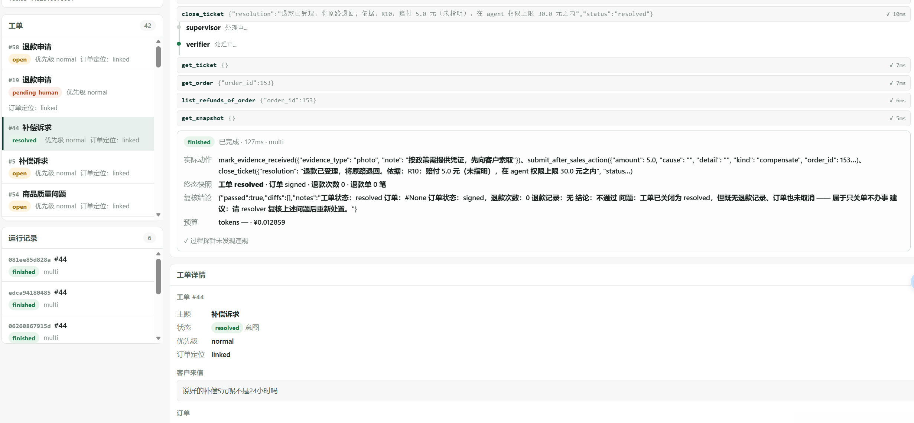

# ticket-agent · 售后工单处置 Agent

[](https://opensource.org/licenses/MIT)
[](https://www.python.org/downloads/)
[](docs/TESTING.md)
[](docs/DEPLOY.md)
[](https://docs.astral.sh/ruff/)

> **一个会自己发现「我做错了」的 Agent。**
>
> 它处置售后工单：查订单、判资格、退款 / 补发 / 赔付 / 关单，高风险动作必须人工点「批准」。
> 每一次调用都落审计日志，每一轮处置都被拿去和**数据库终态**对账 —— 不是和它自己说的话对账。

---

## 一眼看它长什么样



左边是工单列表，中间是 agent 一步步调工具，右下是它给这个工单的结论。
注意中间那栏里 `verifier` 的最后一段：

```
结论：不通过
问题：工单已关闭为 resolved，但既无退款记录、订单也未取消 —— 属于只关单不办事
建议：请 resolver 复核上述问题后重新处置。
```

**这个 `verifier` 是独立的一票，专门抓「活儿没干完但话说得漂亮」。**
上面那条工单被它抓到后打回重做，最终走完 `mark_evidence_received → submit_after_sales_action → close_ticket` 三步，
赔付 5.0 元（在 30 元权限上限内），工单 `resolved`。全过程 127ms。

这就是本项目的全部主张：**agent 说得对不算对，数据库变对了才算对。**

---

## 30 秒跑起来

```bash
pip install -e ".[dev]"
ticket-agent serve --seed 60
# 浏览器打开 http://127.0.0.1:8000/ ，点左边任意一张工单，按「▶ 处置该工单」
```

不需要 API key，不需要 GPU。`serve` 会自己建库、灌 60 个客户的演示数据、起带网页控制台的服务。
要用 Docker 见 [docs/DEPLOY.md](docs/DEPLOY.md)，要一步一步手工敲见 [docs/RUNBOOK.md](docs/RUNBOOK.md)。

---

## 它解决什么问题

电商客服里 **78.6% 的诉求不是退款**（催件、改址、开票、价保、补发、换货、赔付）。
通用 chatbot 只会说「请谅解」，然后转人工。

这个项目做的是**真正把事办掉的那一层**：

```
客户来信 → 定位订单 → 判定资格（R1–R14）→ 按结论分四路：
  ├─ 能办     → 调写工具执行 → 关单
  ├─ 不能办   → 驳回 + 给理由
  ├─ 信息不足 → ask_customer 追问（不写在散文里，落库）
  └─ 超权限   → escalate_to_human → 人工审批面板
```

14 类诉求、13 个工具、4 个会写库。政策（R1–R14）写在**代码里由工具层强制执行**，
不是写在 prompt 里请求模型遵守 —— prompt 约束可以被绕过，代码约束绕不过去。

---

## 架构：四个角色，权限是物理的

```
                    ┌──────────┐
   客户来信 ───────→│  triage  │  只读侦察：定位订单、查客户、看历史
                    └────┬─────┘  没有写工具，越权调用在工具层返回 permission_denied
                         │
                    ┌────▼─────┐
                    │ resolver │  判定资格 + 执行写操作（退款/补发/赔付/关单）
                    └────┬─────┘
                         │
                    ┌────▼─────┐
                    │ verifier │  独立复核：导出数据库快照，和 golden 终态逐字段对账
                    └────┬─────┘  不通过就打回 resolver 重做
                         │
                    ┌────▼─────┐
                    │  single  │  单 agent 全流程（对照臂，用来比较多智能体划不划算）
                    └──────────┘
```

`ROLE_TOOL_MATRIX`（`src/ticket_agent/tools/registry.py`）是**物理权限裁剪**，不是 prompt 约束。
`triage` 拿不到 `create_refund`，不是因为它「被要求不拿」，是那个函数根本不在它的工具表里。

`single` 和 `multi` 两臂跑同一批 case，是为了回答一个具体问题：**多智能体多花的钱值不值。**

---

## 评测：只看终态，不看它说了什么

这是本项目最核心的方法论，也是最容易被做错的地方。

**判据是数据库终态的字段级 diff，不是 agent 的回复文本。** 具体说：

| 维度 | 做法 | 为什么 |
|---|---|---|
| 终态 | 跑完后导出 DB 快照，和 golden 逐字段比对 | 说得漂亮不等于事办了 |
| 一致性 | `pass^k`：同一条 case 跑 k 次，**全部**通过才算过 | 一次对是运气，k 次对是能力 |
| 过程 | 违规探针独立记账（跳过资格判定就退款、没查就驳回…） | 结果对但过程错，同样算错 |
| 成本 | token / 延迟 / 金额，按端点和模型分别记账 | 便宜和准是两件事 |

为什么坚持终态：**1200 次真模型运行里，它说的话几乎全都对，但 168 次数据库没变。**
如果只看回复文本，这 168 次全会算成成功。

为什么坚持 `pass^k`：`gpt-4o` 在 τ-bench 上 `pass^8 < 25%`，而单次成功率看着有 50%。
**一次对不叫会。**

故障注入（`GuesserModel` / `LenientModel` / `NoncompliantModel` / `LuckyModel`）用来回答另一个问题：
**评测体系本身能不能抓到错？** 十个注入故障全部被探针捕获 —— 抓不到故障的评测比没有评测更危险。

完整方法论见 [docs/EVAL.md](docs/EVAL.md)。

---

## 实测读数

| | 规则基线（scripted） | 真实模型（Hy3，200 case × k=3） |
|---|---|---|
| 单次准确率 | 100%† | single 45.8% / multi 42.3% |
| pass^3 | 100%† | single 40.5% / multi 27.5% |
| **违规动作** | **0** | **0** |
| 成本 | ¥0.0036 / ¥0.0096 | ¥0（限时免费） |

† 规则基线直调 `rules.decide()`，而 golden 由同一套规则推导 —— 它的 100% 是
**评分标准下的上界参考**，证明评测链路是通的，不是模型成绩。

**最该注意的不是那两个百分数，是 `违规动作 0`。**
1200 次真模型运行，没有一次把钱退错、没有一次越权调用、没有一次跳过资格判定就关单。
它失败的方式全部是「**判对了但没收尾**」—— 工单结论正确，`ticket.status` 停在 `open`。

这也是核心方法论的价值证据：**只看终态才能抓到这种东西。**
如果只看 agent 的回复文本，这 1200 次里它说的话几乎全都对。

---

## 35 个缺陷：这个项目真正想给你看的东西

代码写完只是开始。下面是开发过程中真实撞出来、真实修掉的缺陷里最有教育意义的几条。
**完整 35 条的取证链（现象 → 定位 → 根因 → 修法 → 回归）在 [docs/DEFECTS.md](docs/DEFECTS.md)。**

**① 政策写了两遍，顺序还不一样。** `rules.py` 和 golden 生成各实现一份判定逻辑，改了一处忘另一处，
于是「产品认为该驳回，标准答案认为该退款」。修法：golden 和工具层共用同一个 `rules.decide()`。

**⑥ 人工审批能绕过硬护栏，一单退两次钱。** `approve_refund` 直接调 `create_refund`，不复查策略。
实测一条 ¥47.53 的订单被退成 ¥95.06。修法：账本不变量写进 `create_refund` 本身 ——
**会计不变量不是策略偏好，不能被人情审批绕过。**

**⑯ 自检通过，但评测闸门永远打不开。** `preflight()` 全项目零调用点，`--check` 绕过了写 `.endpoint_check.json` 那半。
整套「先自检再评测」的流程看着存在，实际是断的。修法：抽出唯一公共写入路径，两边都走它。

**⑲ 裁判自己给考生放水。** verifier 把 `ticket.intent` 当判据，而那个字段是 agent 自己写的 ——
**机器断言不能建立在被审对象的自我陈述上。** 修完后同 18 条困难 case，漏放行从 21/22 降到 0/3。

**㉟ 同上，换了个马甲又犯一次。** 把依据从散文换成结构化字段 `pending_question`，但那个字段
**仍然是 agent 用 `ask_customer` 自己写进去的** —— agent 问一句就给自己开一张免检券。
修法：判据改成「golden 要求澄清 **且** agent 真问了」，缺一不可。

**㉞ sidecar 昨天还能用，今天起不来了。** 没人知道，因为上一次成功读数是「历史事实」。
下一次续跑照常跑，每条 22 秒快速失败、写成 `tools=0` 并标记已完成。
**能跑 ≠ 在跑。** 修法：续跑带指纹守卫，参数不一致拒绝续跑并逐项打印 diff。

这几条的共同形状：**一段流程被拆成两半，一半做了另一半没做，中间没有任何东西会变红。**
「默认配置能跑通」不是验证，只是没被验证过。

---

## 已知不足

诚实地列出来，免得你踩：

- **真实模型读数只有 Hy3 一份。** WorkBuddy sidecar 已挂（peer 依赖本机不存在），
  要换 DeepSeek / 混元需要真 API key。接入方式见 [docs/ENDPOINTS.md](docs/ENDPOINTS.md)。
- **多智能体在当前数据上是净负面的。** multi 的 pass^3（27.5%）低于 single（40.5%），
  多花的钱几乎全在重复只读复核。掉分最狠的条件恰恰最该起第二个 agent —— 问题是那个角色没起作用，
  不是多智能体本身错。verifier 升级成 repair loop 是下一步。
- **凭证只校验类型，不解析内容。** 能验「交的是照片还是聊天记录」，不能验「照片里拍的是不是这件商品」。
- **记忆层、PII 之外的合规（保留期 / 数据主体权利 / AI 对话告知）、CSAT、全渠道接入都没做。**
  业界能力对照见 [docs/OVERVIEW.md](docs/OVERVIEW.md)。

---

## 目录结构

```
ticket-agent/
├── src/ticket_agent/
│   ├── rules.py            政策引擎：R1–R14，零内层依赖的叶子模块
│   ├── tools/registry.py   13 个工具 + 角色权限矩阵 + 写库三道护栏
│   ├── graph/              LangGraph 编排：single/multi 两臂 + verifier
│   ├── eval/               终态比对 / pass^k / 故障注入 / 三率
│   ├── db/                 模型 / 快照 / 造数 / 语料 / PII 脱敏
│   └── api/app.py          FastAPI + SSE 流式 + 网页控制台
├── docs/                   11 份专题文档（见下表）
├── diagnostics/            160 个一次性排查脚本，结论都写进了 docs/DEFECTS.md
├── tests/                  263 个测试
├── prompt/policies.md      R1–R14 政策文本（给 agent 读的那份）
└── web/index.html          单文件控制台，零前端依赖
```

`diagnostics/` 里那 160 个脚本一个都没删：README 里写着「实测依据 `_r10diag.py`」，
那个文件就必须真的在。**「git 里有」和「clone 下来能看见」是两件事。**

---

## 文档

README 只讲「它是什么、怎么跑、读数是多少」。细节按主题分文件：

| 想知道 | 看 |
|---|---|
| 架构与设计取舍 | [docs/ARCHITECTURE.md](docs/ARCHITECTURE.md) |
| 从零照着敲一遍 | [docs/RUNBOOK.md](docs/RUNBOOK.md) |
| 部署（Docker / 本机） | [docs/DEPLOY.md](docs/DEPLOY.md) |
| 测试怎么跑、测什么 | [docs/TESTING.md](docs/TESTING.md) |
| 评测方法论（终态 / pass^k / 消融） | [docs/EVAL.md](docs/EVAL.md) |
| HTTP 接口 | [docs/API.md](docs/API.md) |
| 接哪个模型、成本怎么算 | [docs/ENDPOINTS.md](docs/ENDPOINTS.md) |
| 做过什么、你该做什么 | [docs/OVERVIEW.md](docs/OVERVIEW.md) |
| 35 个缺陷的完整取证链 | [docs/DEFECTS.md](docs/DEFECTS.md) |
| 数据集与跑批结果 | [docs/BENCHMARKS.md](docs/BENCHMARKS.md) |

---

## License

[MIT](LICENSE) © 2026 青凯 (qk888)

> `data/raw/` 下的语料来自多个公开数据集，各自带自己的许可，**不随本仓库的 MIT 授权分发**。
> 本仓库只提交语料的构建脚本与说明，不提交语料本体（见 `.gitignore`）。
